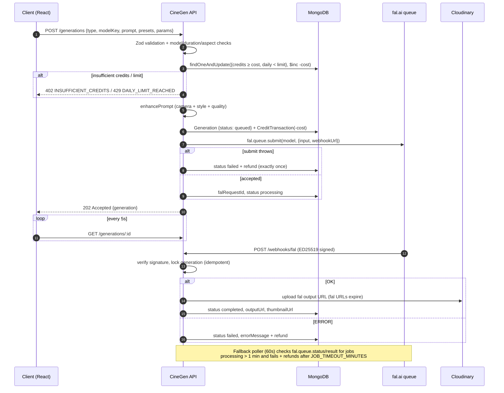

# 🎬 CineGen API

**AI video & image generation platform backend (Higgsfield-style), powered by [fal.ai](https://fal.ai).**


Users sign up, receive free credits, and generate short cinematic videos and images from text prompts or uploaded
images. CineGen turns simple prompts into detailed cinematic prompts (camera-motion + style presets), lets users pick
between multiple AI models through one interface, and manages credits, async job status, history and storage.

---

## ✨ Features

- **JWT auth** (register / login / me) with bcrypt hashing and role-based access (`user`, `admin`)
- **4 AI models out of the box** — budget & premium text-to-video, image-to-video, text-to-image — defined in a
  single config file (`src/config/models.config.js`); adding a model needs no other code changes
- **Prompt enhancement** with 9 camera presets and 6 style presets (template-based, free)
- **Async generation pipeline** — fal.ai queue + signed webhooks + a fallback poller, results copied to Cloudinary
- **Credit system** — atomic debit (can never go negative, safe under concurrency), refund-exactly-once on any
  failure, full transaction ledger, daily generation limit
- **Admin panel API** — users, credit grants/revokes, activation, all generations, stats, model toggles
- **Security** — helmet, CORS allow-list, rate limits, Mongo-operator sanitizing, upload MIME + magic-byte checks,
  ED25519 webhook signature verification, no internal errors leaked
- **Docs & DX** — Swagger UI at `/api/docs`, Postman collection, ESLint + Prettier, GitHub Actions CI
- **50 Jest + Supertest tests** with fal.ai and Cloudinary mocked — tests never spend real credits
- Deployable to **Render** (long-running, in-process poller) or **Vercel** (serverless, cron + on-read refresh)

## 🏗 Architecture — generation flow



## 📁 Project structure

```
src/
├── config/        env (Zod-validated), db, cloudinary, fal, models.config.js, presets.config.js
├── models/        User, Generation, CreditTransaction
├── controllers/   thin HTTP handlers
├── routes/        all routes under /api/v1
├── services/      generation, prompt, credit, storage, webhook (business logic, JSDoc'd)
├── middleware/    auth, validate, rateLimit, upload, sanitize, errorHandler
├── validators/    Zod request schemas
├── jobs/          pollPendingJobs.js (fallback poller)
├── docs/          swagger.js (OpenAPI 3)
├── app.js         express app (no listen)
└── server.js      connect DB + listen + graceful shutdown
api/index.js       Vercel serverless entry
tests/             Jest + Supertest
```

## 🚀 Getting started

**Prerequisites:** Node.js 20+, a MongoDB database (local or free Atlas cluster), a fal.ai key, a Cloudinary account.

```bash
git clone https://github.com/Jeevan2410/CineGen-API.git
cd CineGen-API
npm install
cp .env.example .env      # then fill in the values
npm run dev               # http://localhost:5000  —  docs at http://localhost:5000/api/docs
```

Make yourself an admin after registering through the API:

```bash
npm run seed:admin -- you@example.com
```

### Scripts

| Script                         | What it does                                     |
| ------------------------------ | ------------------------------------------------ |
| `npm run dev`                  | Start with nodemon                               |
| `npm start`                    | Start in production mode                         |
| `npm test`                     | Jest + Supertest (in-memory MongoDB, mocked fal) |
| `npm run lint`                 | ESLint                                           |
| `npm run format`               | Prettier                                         |
| `npm run seed:admin`           | Promote a user to admin                          |
| `node scripts/buildPostman.js` | Regenerate the Postman collection                |

### Environment variables

| Variable                                             | Required | Default       | Description                                                  |
| ---------------------------------------------------- | -------- | ------------- | ------------------------------------------------------------ |
| `NODE_ENV`                                           |          | `development` | `development` / `production` / `test`                        |
| `PORT`                                               |          | `5000`        | HTTP port                                                    |
| `API_BASE_URL`                                       | ✅       |               | Public URL of this API — used to build the fal webhook URL   |
| `CLIENT_URL`                                         | ✅       |               | CORS allow list (comma-separated)                            |
| `MONGO_URI`                                          | ✅       |               | MongoDB connection string                                    |
| `JWT_SECRET`                                         | ✅       |               | ≥ 16 chars, random                                           |
| `JWT_EXPIRES_IN`                                     |          | `7d`          | Token lifetime                                               |
| `FAL_KEY`                                            | ✅       |               | fal.ai API key                                               |
| `FAL_WEBHOOK_VERIFY`                                 |          | `true`        | Verify fal webhook signatures (keep on in production)        |
| `CLOUDINARY_CLOUD_NAME` / `_API_KEY` / `_API_SECRET` | ✅       |               | Cloudinary credentials                                       |
| `SIGNUP_FREE_CREDITS`                                |          | `20`          | Credits granted on registration                              |
| `DAILY_GENERATION_LIMIT`                             |          | `10`          | Generations per user per UTC day                             |
| `JOB_TIMEOUT_MINUTES`                                |          | `15`          | After this, stuck jobs are failed and refunded               |
| `ENABLE_POLLER`                                      |          | `true`        | In-process fallback poller (set `false` on Vercel)           |
| `CRON_SECRET`                                        |          |               | Bearer secret for `/api/v1/internal/poll-jobs` (Vercel Cron) |
| `LOG_LEVEL`                                          |          | `info`        | pino log level                                               |

A missing or invalid variable stops the server at boot with a clear list of what is wrong.

### Getting the keys

- **fal.ai** — sign up at [fal.ai](https://fal.ai), add credits under Billing, then create a key at
  **Dashboard → Keys** and put it in `FAL_KEY`.
- **Cloudinary** — create a free account at [cloudinary.com](https://cloudinary.com); the **Dashboard** shows your
  Cloud name, API Key and API Secret.
- **MongoDB Atlas** — create a free M0 cluster, add a database user, allow network access from `0.0.0.0/0`, and
  copy the `mongodb+srv://…` connection string.

### Testing webhooks locally

fal.ai cannot reach `localhost`, so locally the API doesn't send a webhook URL and the **fallback poller** picks up
results within ~1–2 minutes. To test real webhooks, expose your server with a tunnel and point `API_BASE_URL` at it:

```bash
cloudflared tunnel --url http://localhost:5000     # or: ngrok http 5000
# API_BASE_URL=https://<your-tunnel>.trycloudflare.com
```

## 📚 API

Base path: `/api/v1` · Interactive docs: **`/api/docs`** (OpenAPI JSON at `/api/docs.json`) · Postman:
[`postman_collection.json`](./postman_collection.json)

```jsonc
// success
{ "success": true, "data": { ... }, "meta": { "page": 1, "limit": 10, "total": 42 } }
// error
{ "success": false, "error": { "code": "INSUFFICIENT_CREDITS", "message": "You need 24 credits but have 5." } }
```

| Method | Path                        | Auth     | Description                                                        |
| ------ | --------------------------- | -------- | ------------------------------------------------------------------ |
| GET    | `/health`                   | –        | Status, uptime, DB state                                           |
| POST   | `/auth/register`            | –        | Create account → user + token, grants signup credits               |
| POST   | `/auth/login`               | –        | Log in → user + token                                              |
| GET    | `/auth/me`                  | user     | Profile + credit balance                                           |
| GET    | `/models`                   | –        | Enabled models, costs, durations, aspect ratios (`?type=` filter)  |
| GET    | `/presets`                  | –        | Camera and style presets                                           |
| POST   | `/generations`              | user     | Create a generation → **202** `queued`/`processing`                |
| POST   | `/generations/upload-image` | user     | Multipart `image` (jpg/png/webp ≤ 10 MB) → Cloudinary URL          |
| GET    | `/generations`              | user     | Own generations · `page`, `limit` (≤ 50), `status`, `type`, `sort` |
| GET    | `/generations/:id`          | owner    | One generation (poll every 5 s)                                    |
| DELETE | `/generations/:id`          | owner    | Delete a `completed`/`failed` generation and its asset             |
| GET    | `/credits`                  | user     | Balance + paginated transaction history                            |
| POST   | `/webhooks/fal`             | fal sig. | fal.ai completion webhook (idempotent)                             |
| GET    | `/admin/users`              | admin    | Paginated users, `?search=` by email                               |
| PATCH  | `/admin/users/:id/credits`  | admin    | `{ amount, reason }` — positive grants, negative revokes           |
| PATCH  | `/admin/users/:id/status`   | admin    | `{ isActive }`                                                     |
| GET    | `/admin/generations`        | admin    | All generations · `status`, `user`, `type` filters                 |
| GET    | `/admin/stats`              | admin    | Users, generations by status/model, credits spent                  |
| GET    | `/admin/models`             | admin    | All models incl. disabled                                          |
| PATCH  | `/admin/models/:key`        | admin    | `{ enabled }` toggle (in-memory until restart)                     |
| GET    | `/internal/poll-jobs`       | cron     | Serverless poller trigger (`Authorization: Bearer $CRON_SECRET`)   |

Other users' generations return **404** (not 403) so IDs can't be probed.

### Example: create a video

```http
POST /api/v1/generations
Authorization: Bearer <token>

{
  "type": "text-to-video",
  "modelKey": "ltx-fast",
  "prompt": "a red sports car on a rainy city street at night",
  "cameraPreset": "dolly-in",
  "stylePreset": "neon-noir",
  "imageUrl": null,
  "params": { "duration": 6, "aspectRatio": "16:9" }
}
```

Enhanced prompt sent to the model:

> a red sports car on a rainy city street at night, slow cinematic dolly-in toward the subject, neon-lit noir
> atmosphere, deep shadows, magenta and cyan reflections, wet surfaces, moody high-contrast grade, highly detailed,
> sharp focus, smooth motion

## 🤖 Models

| Key            | Type           | fal endpoint                                           | Durations | Credits     |
| -------------- | -------------- | ------------------------------------------------------ | --------- | ----------- |
| `ltx-fast`     | text-to-video  | `fal-ai/ltx-2/text-to-video/fast`                      | 6, 8, 10s | 4 / second  |
| `kling-v3`     | text-to-video  | `fal-ai/kling-video/v3/standard/text-to-video`         | 5, 10s    | 12 / second |
| `seedance-i2v` | image-to-video | `fal-ai/bytedance/seedance/v1/pro/fast/image-to-video` | 5, 10s    | 6 / second  |
| `flux-schnell` | text-to-image  | `fal-ai/flux/schnell`                                  | –         | 2 flat      |

The Kling, Seedance and FLUX endpoint IDs and input shapes were checked against fal's docs. **Verify
`fal-ai/ltx-2/text-to-video/fast` (duration/resolution enums) on its fal.ai model page before going live**, and
re-check prices — fal adjusts them over time. To add a model, append an entry to `MODELS` with its own
`buildInput` and `extractOutputUrl`; nothing else changes.

## 💳 How credits work

- 1 credit ≈ ₹1 (internal units). Costs are set above fal's list price so each generation is profitable.
- New users get `SIGNUP_FREE_CREDITS` (logged as `signup_bonus`).
- Creating a generation debits the cost with **one conditional update**
  (`{ credits: { $gte: cost }, dailyGenerationCount: { $lt: limit } }` → `$inc`), so balances can never go
  negative, even with parallel requests.
- Any failure — fal submission error, fal error webhook, empty output, timeout — **refunds exactly once**: a
  `refunded` flag is flipped atomically before the balance changes, and a unique partial index on
  `(generation, reason: 'refund')` backs it up.
- Every change is recorded in `CreditTransaction` with `balanceAfter` (`generation`, `refund`, `admin_grant`,
  `admin_revoke`, `signup_bonus`). No payments in v1 — admins grant credits.

## ☁️ Deployment

### Render + Atlas (recommended — matches the PRD)

1. **Atlas:** free M0 cluster → database user → Network Access `0.0.0.0/0` (Render IPs are dynamic) → copy URI.
2. **Render:** New → **Blueprint** and pick this repo (uses [`render.yaml`](./render.yaml)), or New → Web Service
   with build `npm ci` and start `npm start`.
3. Add all env vars; set `API_BASE_URL` to the Render URL (e.g. `https://cinegen-api.onrender.com`) so fal can reach
   `/api/v1/webhooks/fal`.
4. Open `https://<app>.onrender.com/api/docs` and run the Postman collection against it.

> Free Render instances sleep after ~15 min of inactivity; the first request can take up to a minute. Pending jobs are
> reconciled by the poller once it wakes.

### Vercel (serverless)

The repo also ships a Vercel entry (`api/index.js`) and [`vercel.json`](./vercel.json).

1. Import the repo in Vercel (framework preset: **Other**), add all env vars, plus `ENABLE_POLLER=false` and a random
   `CRON_SECRET`. Set `API_BASE_URL` to the Vercel production URL.
2. Serverless functions can't run `setInterval`, so pending jobs are reconciled by (a) fal webhooks, (b) a Vercel
   Cron hitting `/api/v1/internal/poll-jobs` (daily on Hobby; raise the frequency on Pro), and (c) an **on-read
   refresh**: `GET /generations/:id` checks fal directly if the job has been processing for over a minute — so the
   frontend's 5-second polling keeps jobs moving even without webhooks.
3. Vercel limits request bodies to **4.5 MB**, so image uploads above that fail there (Render allows the full 10 MB).

## 🧪 Testing

```bash
npm test
```

Uses `mongodb-memory-server`; set `TEST_MONGO_URI` to run against an existing MongoDB instead. `@fal-ai/client` and
`cloudinary` are mocked with `jest.unstable_mockModule`, so no real credits are spent. Coverage: auth flows,
validation, atomic debit under concurrency, refunds, insufficient credits, daily limits, ownership checks, webhook
idempotency and signature verification, poller/timeouts, admin guards, and uploads.

## 🖼 Screenshots

> _Add screenshots / a GIF of Swagger UI and the frontend here._

| Swagger UI | Generation result |
| ---------- | ----------------- |
| _todo_     | _todo_            |

## 🗺 Roadmap

- Razorpay payments for credit packs
- LLM-based prompt enhancement (behind an env flag)
- Email verification, password reset, refresh tokens
- Public share links / community gallery
- SSE / WebSocket status updates instead of polling

## License

MIT
